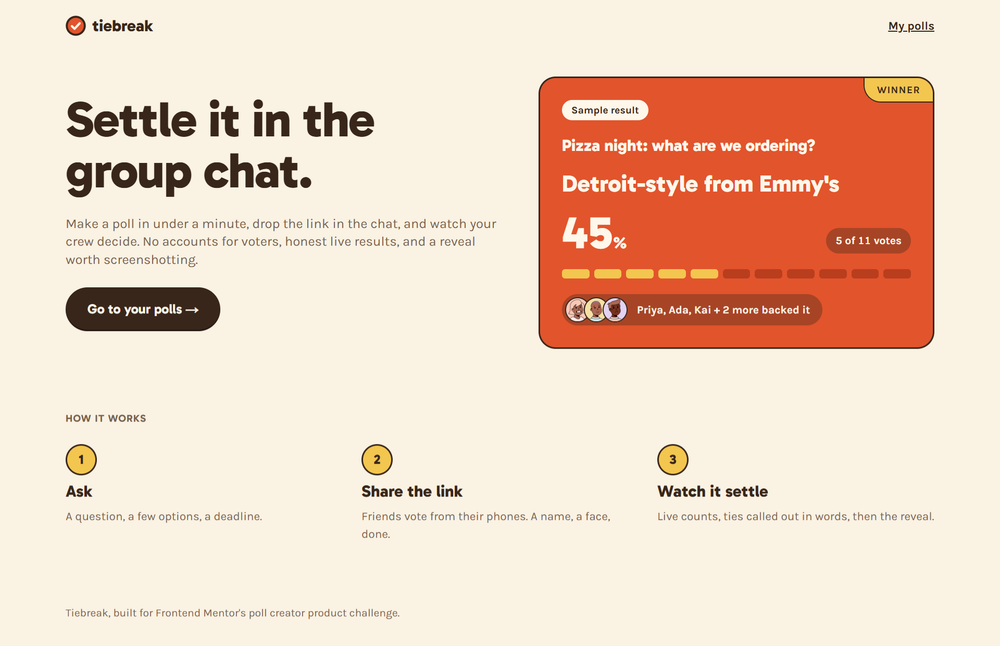

# Tiebreak — Iyanuoluwa Olajide

Group-decision polls that live in the group chat: no accounts for voters, honest numbers at small counts, and a reveal worth screenshotting.

**Challenge:** [Tiebreak on Frontend Mentor](https://www.frontendmentor.io/challenges/poll-creator-app)

**Live URL:** https://poll-creator-app-nine.vercel.app



---

## Overview

Tiebreak is a full-stack build: real creator accounts, a Postgres database, public no-account vote pages, and a poll state machine enforced on the server. A creator makes a poll in under a minute and lands on a share step built around getting the link into the chat. Voters tap through on their phones, pick a name and a face, and vote. They can suggest options, which the creator adds or declines. Results update live, and closing ends in a reveal designed to be screenshotted back into the chat.

"Try it with sample polls" on the landing page gives each visitor their own private copy of the sample data, so a reviewer can do everything a creator can (vote, moderate, end, reopen, run a tiebreaker) without signing up.

### Tech Stack

| Layer | Technology |
|-------|-----------|
| Framework | Next.js 16 (App Router, Cache Components, Partial Prefetching), React 19 |
| Database | Neon Postgres, Drizzle ORM, committed SQL migrations |
| Authentication | Better Auth: Google and GitHub OAuth for creators, anonymous accounts for guest mode |
| Live updates | Pusher Channels push, with a 5-second polling fallback |
| Avatars | `@dicebear/core` + `@dicebear/collection` (micah), rendered on the server |
| Hosting | Vercel, with functions in `iad1` next to the Neon database (US East) |
| Styling | Tailwind CSS v4 mapped onto the brand kit's tokens |
| Testing | Vitest for the pure domain logic (state machine, results maths, drafts, timezones) |

---

## Design Decisions

### The Voter's Side of the Story

**The problem I was solving:** one URL has to serve someone who hasn't voted yet, someone who just did, someone coming back an hour later, and someone arriving after it closed. Nobody should ever think they can vote when they can't.

**My approach:**

- **The ballot comes first.** Until you've voted on an open poll, you see no counts at all. This is enforced on the server: the counts aren't in the page's data, so it can't be bypassed with dev tools.
- **After voting, counts but never names.** You see the live race in counts, never who voted for what. Attribution appears only when the poll settles.
- **The confirmation uses the identity you just gave.** It shows your chosen face and says "You're in, Priya. You backed Veggie supreme. No takebacks: your vote is locked in." It takes focus once, with a small stamp-in, then stays put on later visits.
- **Return visits** show the same confirmation and the live counts. There's no second ballot.
- **Latecomers get the answer first:** "Voting's closed: the crew picked Detroit-style from Emmy's", then the full result with backers. There's no apology and no promotional nudge.
- **Each state names itself** right under the poll title, so the three states can't be confused.

**Why I chose this approach:** seeing the race before voting turns a poll into a bandwagon. Showing counts after voting rewards participation without exposing anyone's choice early. The latecomer is still affected by the decision (they're coming to the brunch too), so they get the answer, not a dead end.

**What I'd do differently:**

I'd test on a phone as soon as the vote page works, to check responsiveness across different screen sizes. I only tested on one Android phone, besides the dev tools in the desktop browser.

### The Reveal

**The problem I was solving:** closing a poll is the payoff. It has to communicate the result, credit the crew, survive being cropped into a group-chat screenshot, and still work for a tie and with motion turned off.

**My approach:**

- **The settled result is one self-contained tangerine card:** the question, the winner, "45% · 5 of 11 votes", the per-voter tally, "Priya, Ada, Kai + 2 more backed it" with their faces, and "Settled Saturday · tiebreak". A screenshot of the card alone makes sense without any context.
- **The reveal plays once per device.** The winner's ticks light up one by one, the name stamps in, the ribbon drops and a small butter burst follows, about 1.5 seconds in all. An inline script decides before the first paint whether this device has seen the result yet, so there's no flash of the finished card. Reopening a poll and settling it again plays a fresh reveal.
- **Reduced motion gets the finished card immediately,** at full strength: all delays and durations collapse and the burst never appears. Colour, size and copy carry the occasion.
- **A tie is unfinished business.** "It's a tie · Tied at 3 votes each" shows the tied options side by side with their backers. The creator gets **Run a tiebreaker**: a one-hour, single-choice re-vote of just the tied options, which lands straight on its share step. Voters see "Morgan will break the tie."
- **Copy result copies text, Copy link copies the URL:**

  ```
  Pizza night: what are we ordering?
  Winner: Detroit-style from Emmy's (5 of 11 votes)
  Priya, Ada, Kai + 2 more backed it.
  Settled on Tiebreak
  https://…/p/k3f9…
  ```

**Why I chose this approach:** the card-as-screenshot follows from the product living in the chat: the image is what travels. Playing the reveal once keeps it special; a fifth replay is friction. And since the product is called Tiebreak, a tie gets a way forward rather than a shrug.

**What I'd do differently:**

I'd allow voters to see the names of those who have voted, once they've successfully voted themselves.

### First Run

**The problem I was solving:** a brand-new creator on an empty dashboard decides in seconds whether this is worth their group chat's attention.

**My approach:**

- **The empty dashboard is the first question:** "What does your crew need to decide?", with an input and the screen's one tangerine button, **Start a poll**, which carries the title into the form. It's a plain HTML form, so it works before JavaScript loads. Below it sits a clearly labelled example poll ("Example, not a real poll") showing what a poll turns into.
- **The form is deliberately small.** Enter moves you forward and adds the next option. The closing time is a set of quick picks in your own timezone (Tomorrow at 7 PM is the default) plus a custom date and time.
- **Creating a poll lands on a share step:** "Your poll is ready. Now drop it in the chat." It offers the phone's native share sheet where available, Copy link everywhere, a preview of what voters will see, and then "Go to your poll".
- **The in-between state** (one open poll, zero votes) features that poll with "Drop the link in your group chat. Votes show up here the moment they land."

**Why I chose this approach:** designing backwards from the success case (a link sitting in a group chat), every first-run element points at that link. Typing the question is the quickest way to start, and the example shows the payoff without faking data.

### Product Rules I Decided

- **Reopening requires a new closing time.** The confirm dialog offers presets (in 1 hour, in 3 hours, tonight, tomorrow). The invariant: an open poll always has a future deadline, so automatic closing is always true.
- **One vote per browser.** An httpOnly cookie gives each browser a voter token, and the database enforces one ballot per token per poll. Casting is idempotent: a refresh or a double tap replays the same vote rather than adding one, while a different choice from the same browser is rejected ("No takebacks"). A determined friend with two browsers gets two votes. For pizza night, that's the right bar.
- **Past 20 voters, the leader's tally becomes a bar.** Up to 20, it's one tick per voter. Beyond that, ticks turn to noise, so it switches to a share bar; the counts stay in text either way.
- **Percentages on multi-choice polls are out of voters, not picks:** "picked by 3 of 5 voters".
- **Declined suggestions** disappear from the queue, with an 8-second undo toast; the server allows 10 seconds. A declined idea can be suggested again later, and a duplicate of a live or pending option can't.
- **Moderation only while open.** Approving onto a decided ballot would change nothing, so the server refuses approvals on settled polls and the UI hides the queue. Declining is still allowed, for tidying up.
- **Polls settle lazily.** The first read after the deadline records the settle. Open pages also refetch just after the deadline, so the closed state appears without anyone acting.
- **Guest sandboxes last 24 hours.** Each guest gets a private copy of the sample polls, with timestamps shifted so pizza night "closes today". Expired guests are swept whenever a new guest arrives, so no cron job is needed. A guest who then signs in with OAuth starts clean.
- **The unguessable poll id is the access control** for public pages: 12 characters of `[a-z0-9]`, about 62 bits. Creator pages check ownership, and someone else's poll is indistinguishable from a missing one, in the tab title as well as on the page.

### Other Design Choices

- **Avatars:** 8 preset faces plus 4 tints; the brief favours picking a game piece over an avatar builder. Faces render on the server with a transparent background and the tint applied in CSS. A face that fails to render falls back to a tinted circle with an initial.
- **Honest results:** the leader gets a per-voter tally, trailing options get bars relative to the leader (3 votes against a 5-vote leader draws a 60% bar), every percentage sits beside its count, and ties are stated in words: "Pepperoni and Veggie supreme are tied at 3 votes each." A single vote reads "First vote's in. Too early to call."
- **Brand kit:** used as given, keeping to one tangerine moment per screen. Small text on tangerine sits on the cocoa scrim to meet AA.
- **Data model:** this deviates from the spec's flat votes table on purpose. A `ballots` table (one per voter per poll, holding the name and face) plus `votes` (one row per pick) makes "one ballot per voter" a single unique constraint and keeps pick-up-to-N simple.

---

## Development Journey

I picked Tiebreak because I wanted to build something real, not just a static page: accounts, a database and live updates. The core features came together faster than I expected; deploying was the hardest part. Most problems weren't in my code but in configuration: a wrong URL here, a cut-off secret there. I learned to read error messages carefully before changing anything. I'm proudest of building a full-stack project from scratch.

**Notable turns during the build:**

- **Auth.js → Better Auth.** I switched before scaffolding, because Auth.js v5 was still in beta and in maintenance mode.
- **Next.js 16 rules.** Cache Components shaped a lot:
  - session reads live behind `<Suspense>`;
  - data loaders call `connection()` before reading the clock;
  - per-poll page titles read the database per request.
- **Accessibility fixes from browser testing:**
  - Disabled buttons dropped keyboard focus while actions ran, so they became `aria-disabled`.
  - Undo was briefly unclickable while the page refreshed.
  - Enter-to-add-an-option lost keystrokes typed before the next frame, so it now uses `flushSync`.
- **Deploying taught its own lessons:**
  - The first Vercel build failed on an invalid `BETTER_AUTH_URL`.
  - Google sign-in returned `invalid_client` because the pasted client secret had been cut short.
  - Each OAuth provider needs the production callback URL registered alongside the localhost one.
  - Database queries occasionally failed when a WebSocket connection to Neon dropped while opening. Opening a connection now gets one quick retry. That's safe because nothing has reached the database yet.
  - Files checked out with Windows line endings broke the formatter, so `.gitattributes` now pins LF.

### Session Breakdown

| Session | Focus | What I Accomplished |
|---------|-------|-------------------|
| 1 (Oct 29) | Kickoff | Path, stack and product rules decided; starter files committed |
| 2 (Oct 31) | Foundations | Next.js scaffold, schema and state machine with tests, Neon migration, Google/GitHub sign-in |
| 3 (Nov 1) | Core flows | Guest sandbox, dashboard, creator poll page with moderation, vote page, live updates via Pusher |
| 4 (Nov 1–2) | Design challenges and polish | Poll creation, share step and first run; the reveal and tiebreaker; landing page, titles, 404s, skip link |
| 5 (Nov 2–3) | Deploy | README, GitHub and Vercel deploy, production OAuth, database connection retry |

---

## AI Collaboration Reflection

I built this with Claude (Claude Code) as a pair. I made the product and design decisions; Claude proposed options with a recommendation, then implemented and tested what I chose.

### Where I Pushed Back

- **The live results screen:** `preview.jpg` shows the crew's avatars while voting is open, and that was the recommendation. I chose a **count only**, keeping the rule that nobody is identified until the poll settles.

### How I Used AI

I used AI as a collaborator for brainstorming and implementation, while I made the design decisions and handled the product thinking, engineering and review.

---

## Differentiators

### Chosen Differentiator(s)

**1. Truly live results**

- **Why I chose this:** the race happening in real time is the reason to keep the poll open on your phone.
- **How it enhances the product:** a vote lands on the creator's page and on every voter's results without anyone refreshing. Ending a poll flips every open voter page to the reveal.
- **Implementation highlights:**
  - After each write, the server sends a data-free "poll changed" event on the poll's Pusher channel. It's sent after the response, so nobody waits on it, and a Pusher outage can never fail a vote.
  - Pages refetch through the server, which decides what each viewer may see, so the ballot-first rule holds.
  - Bursts of events are batched into one refetch, the page catches up once after a dropped connection, and it falls back to polling every 5 seconds.
  - One polite live region announces the race in words, at most every 10 seconds.

**2. Share card**

Planned, not built yet. The link preview image for a poll is still to come.

---

## Self-Assessment

I'd rate myself 8 out of 10. Next, I'm focusing on making the app more scalable, refining its design decisions, and making it responsive across all screens.

I ran the app on the live site with real votes, testing every feature and leaving no stone unturned.

| Category | Rating | Notes |
|----------|--------|-------|
| **Works for real users** | 4/5 | Deployed on Vercel; sign-in, guest mode and voting run against the production database |
| **The vote page** | 4/5 | Checked on one Android phone and in desktop dev tools |
| **Honest results** | 4/5 | Tally, relative bars, counts with every percentage, ties in words, 20-voter threshold |
| **State machine integrity** | 4/5 | Every transition is server-side, in locked transactions; 74 unit tests |
| **The reveal** | 4/5 | Once-per-device motion, tie flow; reduced motion is coded but hasn't been seen in a browser |
| **Design quality** | 4/5 | |
| **Responsive design** | 4/5 | Desktop and one Android phone checked; other devices not yet |
| **Performance** | 4/5 | Functions run in the same region as the database; Lighthouse performance 96–100 on mobile and desktop |
| **Accessibility** | 4/5 | Keyboard paths, focus management, live regions and skip link built; no screen-reader pass yet |
| **Landing page & guest experience** | 4/5 | |

### Lighthouse Scores

Measured on the live site with Lighthouse 13.5, Nov 4, 2026. Mobile is an emulated Moto G Power on slow 4G.

| Page | Device | Performance | Accessibility | Best Practices | SEO |
|------|--------|-------------|---------------|----------------|-----|
| Landing (`/`) | Mobile | 100 | 100 | 100 | 100 |
| Landing (`/`) | Desktop | 100 | 100 | 100 | 100 |
| Creator dashboard (`/polls`) | Mobile | 96 | 100 | 100 | 100 |
| Creator dashboard (`/polls`) | Desktop | 100 | 100 | 100 | 100 |
| Vote page (`/p/…`) | Mobile | 96 | 100 | 100 | 91 |
| Vote page (`/p/…`) | Desktop | 100 | 100 | 100 | 91 |

The vote page's SEO 91 is one flagged audit, "no meta description." The description is there, but the vote page's title comes from the poll, so Next.js streams that page's metadata after the head to keep the first paint fast, and Lighthouse only looks in the head. Link-preview bots such as WhatsApp's get it in the head, which is what matters for a link dropped in the chat.

### Strengths

Designing a full-stack application from scratch, deploying it online and making it as functional as possible, figuring it all out with the help of AI as a collaborator.

### Areas for Improvement

Building more full-stack projects to strengthen my skills in database management and backend development.

---

## Known Limitations

- **Not yet verified:**
  - layouts on devices other than one Android phone, such as iPhones and the smallest (320px) screens;
  - a real screen-reader pass;
  - the reduced-motion reveal, seen in a browser;
  - the polling fallback, the reconnect catch-up and the automatic flip to the closed state at the deadline. These are coded but haven't been watched happening.
- **A missing poll's page returns HTTP 200 with `noindex`.** The page streams before the lookup fails. People see a designed 404 and search engines skip it.
- **No rate limiting** on guest creation, votes or suggestions beyond the database rules.
- **Stretch features not built:** the 30-day retirement of settled polls (stretch 12), manual poll deletion, saved voter identity for account holders (stretch 11; this device already remembers your name and face), and dark mode (stretch 14).
- **Polls can't be edited** after creation.

---

## Running Locally

```bash
git clone https://github.com/Iyanu22/poll-creator-app.git
cd poll-creator-app
pnpm install

cp .env.example .env.local   # then fill in the values (see docs/SETUP.md)
pnpm db:migrate              # create the tables in your Neon database
pnpm dev
```

`docs/SETUP.md` walks through getting each value: Neon, the Better Auth secret, the Google and GitHub OAuth apps, and Pusher. Every one comes from a free tier.

Other scripts: `pnpm test` (Vitest), `pnpm typecheck`, `pnpm lint`, `pnpm format`, `pnpm db:generate` after schema changes, `pnpm db:studio`.

### Environment Variables

| Variable | Description |
|----------|------------|
| `DATABASE_URL` | Neon pooled connection string, used by the app |
| `DATABASE_URL_UNPOOLED` | Neon direct connection string, used by migrations |
| `BETTER_AUTH_SECRET` | Random secret (`openssl rand -base64 32`) |
| `BETTER_AUTH_URL` | The app's base URL, e.g. `http://localhost:3000` |
| `GOOGLE_CLIENT_ID` / `GOOGLE_CLIENT_SECRET` | Google OAuth client |
| `GITHUB_CLIENT_ID` / `GITHUB_CLIENT_SECRET` | GitHub OAuth app (one per environment) |
| `PUSHER_APP_ID` / `PUSHER_SECRET` | Pusher Channels server credentials |
| `NEXT_PUBLIC_PUSHER_KEY` / `NEXT_PUBLIC_PUSHER_CLUSTER` | Pusher client key and cluster. Without them, pages fall back to polling |

---

## Acknowledgments

Built as a [Frontend Mentor Product Challenge](https://www.frontendmentor.io). Sample poll data provided in the challenge starter; avatars by [DiceBear](https://www.dicebear.com) (micah style).
